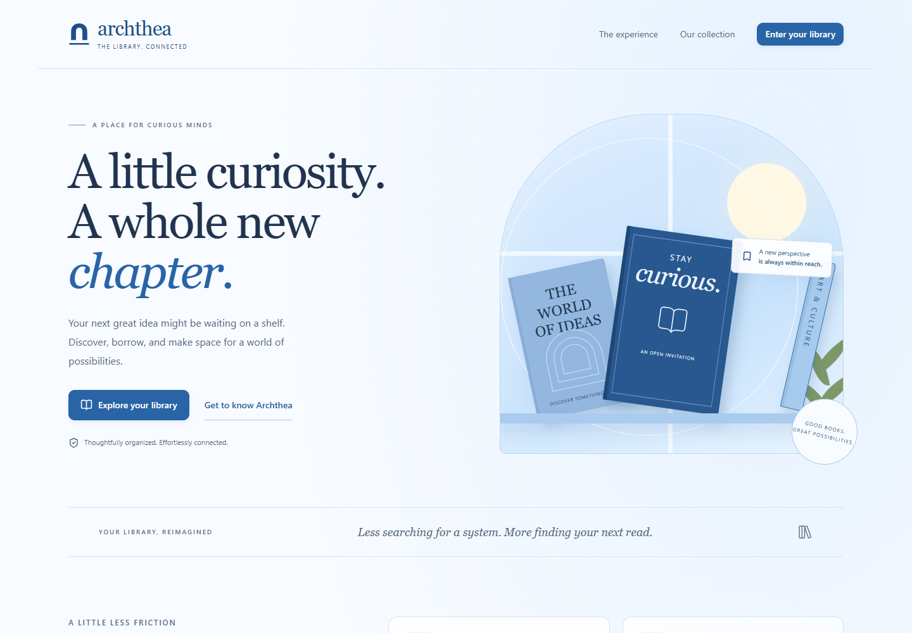

# Archthea

### A place for curious minds.

Archthea is a library management platform that brings discovery, borrowing, reservations, and collection management into one connected workspace.

[Live platform](https://archthea-library.onrender.com/)

## The library, connected

- **Discover the collection.** Search by title, author, or ISBN, with category and availability filters and detailed book information.
- **Keep circulation moving.** Manage individual copies, borrowing eligibility, due dates, returns, and transaction history.
- **Make reservations fair.** First-come, first-served queues coordinate pickup allocations, collection deadlines, and expiration.
- **Give each role a clear workspace.** Students track their reading activity while librarians manage inventory, accounts, policies, and reports.
- **Stay informed.** In-app notifications surface due dates and pickup updates, with administrative activity recorded in audit logs.
- **Understand library activity.** Borrowing trends, popular titles, category insights, and exportable reports support daily decisions.

## Built with JavaScript

| Layer                  | Technology                                           |
| ---------------------- | ---------------------------------------------------- |
| Interface              | React, Vite, React Router, CSS, Lucide               |
| Motion                 | GSAP, ScrollTrigger, Framer Motion                   |
| API                    | Node.js, Express, Zod                                |
| Data and identity      | Supabase PostgreSQL, Authentication, private Storage |
| Hosting and scheduling | Render, Supabase Cron                                |

The React frontend communicates with a layered REST API. Express verifies authentication and role permissions, while PostgreSQL functions coordinate transactional inventory changes and reservation queues. Row Level Security, server-side validation, private file storage, and request-level authorization protect application data.

## Designed for everyday reading

Soft blue surfaces, white cards, and navy typography create a calm interface across desktop, tablet, and mobile. Keyboard navigation, clear feedback, accessible contrast, and reduced-motion support carry through both workspaces.

## Project reference

- [Project manual](output/pdf/Archthea_Project_Manual.pdf)
- [Architecture](docs/architecture.md)
- [UML class diagram](docs/class-diagram.md)
- [Data relationships and workflows](docs/workflows.md)
- [API specification](docs/openapi.json)
- [Security model](docs/security.md)
