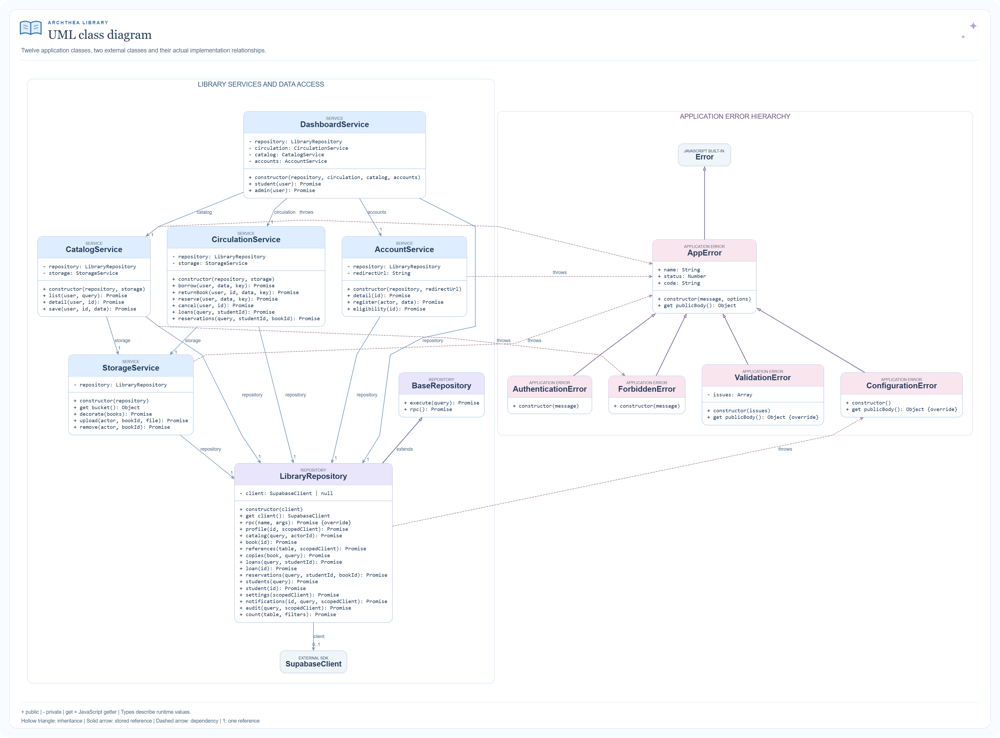
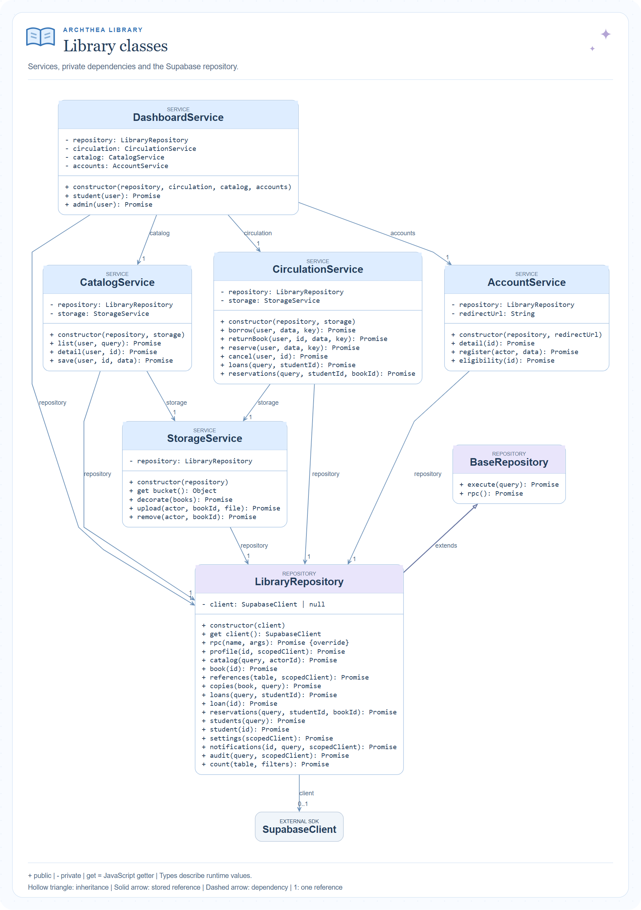
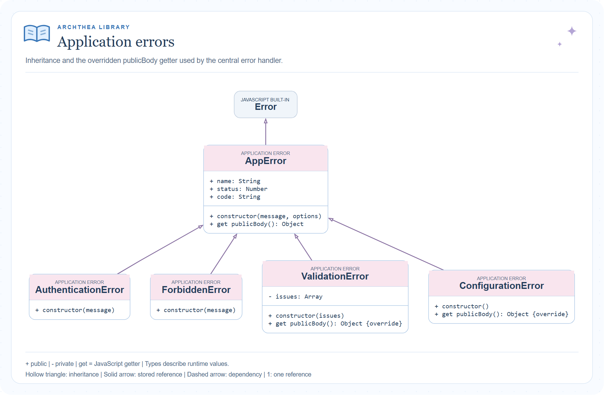

# Archthea UML class diagram

The diagram follows the JavaScript class declarations in `backend/src/services/`, `backend/src/repositories/` and `backend/src/models/`. It includes all **12 application classes, 16 explicitly initialized fields and 50 explicitly declared operations**, including constructors and getters. JavaScript's built-in `Error` and the external `SupabaseClient` are shown as external classes.

## Full diagram

For PowerPoint, use the [compact 16:9 PNG](diagrams/archthea-class-diagram-compact.png) or [compact SVG](diagrams/archthea-class-diagram-compact.svg). It retains all 12 application classes, 16 fields and 50 operations. Parameter lists and repeated type labels are abbreviated. The larger versions below preserve full signatures and explicit error dependencies.

- [Scalable SVG](diagrams/archthea-class-diagram.svg)
- [Editable Graphviz DOT](diagrams/archthea-class-diagram.dot)
- [Editable Mermaid source](diagrams/archthea-class-diagram.mmd)

The PNG uses a pastel-blue, lavender and blush palette with book and sparkle details. Use the SVG when resizing for print. For a report with ordinary page sizes, use the two larger detail views below on separate pages.

## Library services and data access

[SVG](diagrams/library-classes.svg) | [Editable DOT](diagrams/library-classes.dot)

## Application error hierarchy

[SVG](diagrams/error-classes.svg) | [Editable DOT](diagrams/error-classes.dot)

## UML notation and JavaScript mapping

| Notation                             | Meaning in this implementation                                                                     |
| ------------------------------------ | -------------------------------------------------------------------------------------------------- |
| `+`                                  | Public field, constructor, method or getter.                                                       |
| `-`                                  | Private JavaScript field declared with `#`.                                                        |
| Hollow triangle pointing to a parent | Class inheritance using `extends`.                                                                 |
| Solid open arrow                     | A stored, navigable reference to another object.                                                   |
| Dashed open arrow                    | A dependency, such as constructing and throwing an error.                                          |
| `1` at a target                      | Each source object holds one reference to that target object.                                      |
| `0..1` at SupabaseClient             | The repository may initially receive `null`; its public client getter rejects unconfigured access. |
| `{override}`                         | An implementation replaces an inherited method or getter. Constructors are listed separately.      |
| `get property()`                     | A JavaScript getter, accessed as a property in code, such as `error.publicBody`.                   |

Types describe runtime values and intended injected dependencies; the implementation uses JavaScript. `Promise` includes both `async` methods and methods returning a repository promise. In the Mermaid version, `SupabaseClient?` is a compact nullable type label. Parameters retain their source names; default values are omitted for readability. `AppError`'s destructured second constructor argument is labeled `options`, containing `status`, `code` and `cause`.

Fields inherited from a parent are not repeated in every subclass. The external classes are shown with collapsed members. `AppError` inherits the standard error message and cause from `Error`.

The injected service and repository objects have independent lifetimes and can be shared, so their links are ordinary associations. No protected members are declared. `BaseRepository` provides a base contract whose `rpc()` method throws until implemented; it is an ordinary JavaScript class.

## Correspondence with source code

| Class                            | Source                                                                   |
| -------------------------------- | ------------------------------------------------------------------------ |
| DashboardService                 | [DashboardService.js](../backend/src/services/DashboardService.js)       |
| CatalogService                   | [CatalogService.js](../backend/src/services/CatalogService.js)           |
| CirculationService               | [CirculationService.js](../backend/src/services/CirculationService.js)   |
| AccountService                   | [AccountService.js](../backend/src/services/AccountService.js)           |
| StorageService                   | [StorageService.js](../backend/src/services/StorageService.js)           |
| BaseRepository                   | [BaseRepository.js](../backend/src/repositories/BaseRepository.js)       |
| LibraryRepository                | [LibraryRepository.js](../backend/src/repositories/LibraryRepository.js) |
| AppError and its four subclasses | [AppError.js](../backend/src/models/AppError.js)                         |

[createApp()](../backend/src/app.js) creates the repository and service instances, then passes dependencies through their constructors. The diagram shows those stored references.

[errorHandler()](../backend/src/middleware/errors.js) reads the common `publicBody` getter. `ValidationError` and `ConfigurationError` override it, providing a concrete polymorphism example. The full diagram also includes the explicit error-construction dependencies from CatalogService, StorageService, AccountService and LibraryRepository.

Database entities such as books, students and loans are PostgreSQL records returned as objects. The React UI uses function components. This diagram depicts the actual backend classes; database relationships are documented in [workflows.md](workflows.md).

## Presentation explanation

"Archthea separates library use cases from database access. Services keep their dependencies in private fields and expose public operations. LibraryRepository inherits shared query execution from BaseRepository and implements its RPC contract. Application errors share an AppError parent, while specialized errors override the publicBody getter. Constructor injection connects the objects used by the running application."

The class members were extracted from JavaScript syntax trees and checked against the rendered output. The images were inspected for clipping and legibility. No application behavior was changed to produce the diagram.

Rendering reference: [Graphviz arrow shapes](https://graphviz.org/doc/info/arrows.html), [Graphviz class-table labels](https://graphviz.org/doc/info/shapes.html#html), [Viz.js API](https://viz-js.com/api/).
