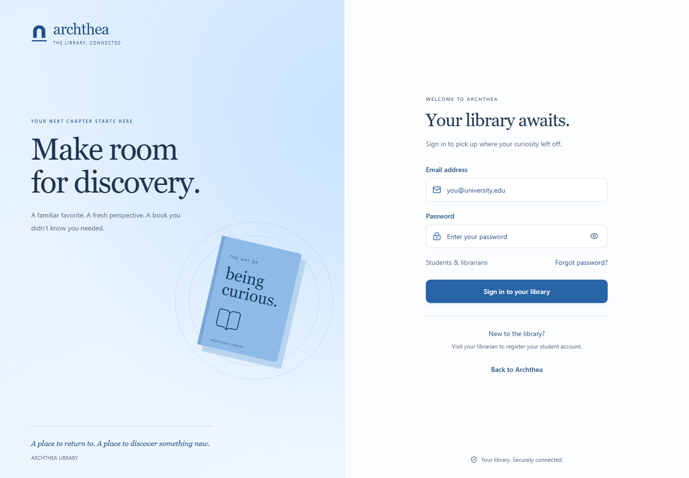
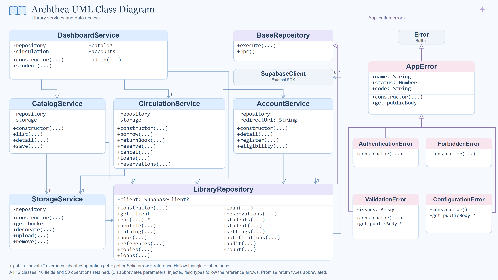

# Archthea Project Manual

Version 1.0 | 26 November 2026 | Application baseline b3c019d

Use this manual as a common source for project descriptions, operational procedures, diagrams and technical explanations. The contents and PDF bookmarks link to each chapter.

## 1. Purpose and document control

Archthea is a web-based library management system for physical books. This manual explains its workflows, software structure, data model, security controls, operating requirements and documentation evidence. It is intended for teammates writing project documents and for maintainers responsible for the application.

| Reference               | Value                                                                                                                   |
| ----------------------- | ----------------------------------------------------------------------------------------------------------------------- |
| Document version        | 1.0, prepared 26 November 2026, Asia/Singapore                                                                          |
| Application baseline    | b3c019d: deployed light blue interface. This manual and the presentation diagrams are documentation additions.          |
| Live application        | https://archthea-library.onrender.com/                                                                                  |
| Source repository       | https://github.com/vennZip/archthea-library-management-system                                                           |
| Primary source of truth | The committed application code, SQL migrations and API contract. Live library policies can differ from schema defaults. |
| Sensitive material      | Passwords, access tokens, service-role values, reset links and private borrower records are deliberately excluded.      |

### How the team should use this manual

Use the operational chapters to explain what each role can do. Use the architecture, OOP, database and API chapters to support technical claims. Use the documentation chapter to organize your own report. Preserve source references and distinguish expected behavior from behavior observed during a particular verification session.

This manual describes the implemented application. Suggested maintenance practices and future improvements are identified as recommendations. They do not imply that a feature is already implemented or that a verification activity has been performed.

Source: docs/architecture.md; docs/security.md; docs/openapi.json; supabase/migrations/

## 2. System overview and boundaries

Archthea connects students or borrowers with library staff. Students discover titles, borrow available copies, reserve unavailable books and track due dates. Librarians maintain the catalog, physical stock, borrower accounts and circulation activity. Both roles use Supabase identities, with current role and status stored in application profiles.

### Implemented capabilities

- Catalog search by title, author or ISBN, with category, availability and publication-year filters, sorting and pagination.
- Individual-copy tracking with unique barcodes, condition, availability and retirement history.
- Atomic borrowing and returns, eligibility rules, preserved due dates and complete loan records.
- First-come, first-served reservations with pickup deadlines, cancellation, expiration and notifications.
- Student provisioning, account activation, manual restrictions and librarian-wide record access.
- Dashboards, in-app messages, library policies, audit records, reports, CSV export and browser print/save PDF.

### Boundaries

The system manages physical lending. It does not implement monetary fines, payment processing, e-book delivery, RFID hardware integration or a separate public registration workflow. Book covers are presentation assets, not downloadable book files. Public pages introduce Archthea; catalog and circulation access require an active registered account.

The frontend has no production demo-data fallback. Browser fixtures support isolated verification only. Availability and overdue status are derived from current records instead of being maintained as independent counters.

Source: frontend/src/app/router.jsx; backend/src/routes/api.js; supabase/migrations/202611250001_schema.sql

## 3. System architecture

Archthea uses separate React/Vite and Express source applications with Supabase PostgreSQL, Authentication and private Storage. The deployed Render Node service serves the built React assets and the API under a single HTTPS origin. Shared hosting does not merge frontend and backend responsibilities.

| Layer                | Responsibility                                                                                                              |
| -------------------- | --------------------------------------------------------------------------------------------------------------------------- |
| React interface      | Routing, forms, application state, feedback, accessibility and presentation. Supabase handles browser authentication.       |
| REST API             | Verifies bearer tokens, loads the current active profile, checks roles, validates input and delegates authorized use cases. |
| Services             | Catalog, circulation, account, storage and dashboard coordination through JavaScript objects.                               |
| Repositories         | Supabase query execution, pagination, result shaping and consistent database-error conversion.                              |
| PostgreSQL functions | Transactional library rules, inventory allocation, reservation promotion, notification records and audit writes.            |
| External services    | Supabase Auth identities, private cover objects, SMTP account mail and database Cron schedules.                             |

### A borrowing request

1. The browser requests a loan with its bearer token and a UUID Idempotency-Key.

2. Express verifies the identity and active profile, validates the request and delegates to CirculationService.

3. LibraryRepository calls borrow_book using the backend-only Supabase client.

4. PostgreSQL locks circulation, checks the current account and policy, allocates a copy and creates the loan, notification, audit and replay result atomically.

5. The API returns the committed result. The interface refreshes the relevant records.

Source: backend/src/app.js; backend/src/middleware/auth.js; backend/src/services/CirculationService.js; supabase/migrations/202611250002_circulation.sql

## 4. Roles and access matrix

The application role values are STUDENT and LIBRARIAN. A profile must also be ACTIVE. A hidden menu is a usability measure; backend authorization and database rules enforce the actual permissions.

| Capability                  | Student / borrower                                         | Librarian                                              |
| --------------------------- | ---------------------------------------------------------- | ------------------------------------------------------ |
| Catalog and book details    | Non-archived titles                                        | All permitted titles, including archived records       |
| Borrowing                   | Own account when eligible                                  | Process a checkout for a selected student              |
| Returns                     | View due dates and history                                 | Record physical returns and condition                  |
| Reservations                | Create own request, collect ready hold, cancel own request | Monitor queues, process pickup and cancel reservations |
| Loan and account records    | Own permitted data                                         | Student records across the library                     |
| Inventory and book editing  | No administrative access                                   | Create, edit, archive and manage copies                |
| Profile editing             | Own full name and Auth password change                     | Own full name plus administrative student management   |
| Policies, reports and audit | View relevant borrowing policy                             | Configure rules, view reports and audit history        |
| Public signup               | Unavailable                                                | Register students through the administrative workflow  |

Librarian roles are provisioned through controlled administration, not user-editable metadata. Deactivating an account blocks later protected API requests. Outstanding loans remain recorded. A manual borrowing restriction is separate from account activation.

Source: backend/src/middleware/auth.js; backend/src/routes/api.js; frontend/src/features/auth/AuthProvider.jsx; supabase/migrations/202611250003_management.sql

## 5. Sign-in, recovery and account access



1. Open the Archthea website and choose Enter your library.

2. Enter the registered email and password. Supabase authenticates the identity; Express then checks the library profile.

3. Successful sign-in opens the role-appropriate workspace. If credentials fail, verify the address and use Forgot password when needed.

4. Use the recovery email to open the reset-password page and choose a new password. Expired or already-used links require a new recovery request.

5. Use My account for the permitted full-name update and Change my password. Use Sign out to end the browser session.

A student account must first be registered by a librarian. Successful provider authentication does not bypass a missing or inactive library profile. A connection notice means the backend or environment is not ready; it is not a password error.

Account setup and recovery email use Supabase Auth with its configured SMTP provider and allowlisted production redirects. Operational notifications such as due reminders are stored inside Archthea.

Source: frontend/src/features/auth/AuthPages.jsx; frontend/src/features/account/AccountPage.jsx; backend/src/middleware/auth.js

## 6. Student guide: discovery and borrowing

### Dashboard and catalog

The student dashboard summarizes active loans, approaching due dates, active reservations, waiting position, recent history and popular titles. Open Explore books to browse the catalog. Search terms may include punctuation. Apply category, availability or publication-year filters, then choose the sort order. Pagination and grid/list views support larger collections.

### Borrow an available title

1. Open a book detail page and review its title, authors, publisher, ISBN, category and current copy counts.

2. Choose Borrow this book when it is available and review the confirmation.

3. Confirm the action once. The server checks account status, manual restrictions, overdue rules, loan limits, queue priority and physical-copy availability.

4. After success, review My borrowed books and the recorded due date. The due date uses the policy effective when the loan was created.

5. Return the physical book to library staff. A librarian records the actual return; the student interface does not close loans directly.

Availability can change between opening a page and confirming a request. A conflict response means the current database state prevented allocation. Refresh the title, review the message and reserve it if it has become unavailable. A displayed available count does not override another reader's valid pickup allocation.

### What to record in documentation

Capture the real search criteria, book detail, confirmation and resulting loan. Redact personal information. Describe the backend eligibility decision and inventory change, rather than presenting the button click as the whole transaction.

Source: frontend/src/features/dashboard/DashboardPage.jsx; frontend/src/features/catalog/CatalogPage.jsx; frontend/src/features/catalog/BookDetailPage.jsx; backend/src/services/CirculationService.js

## 7. Student guide: reservations and history

1. Open an unavailable title and choose Join the waiting list. Confirm the reservation.

2. Open Reservations to check whether the request is WAITING or READY_FOR_PICKUP. A waiting request shows a position calculated from the active queue.

3. When a copy is allocated, review the in-app notification and Collect before deadline.

4. Collect the book through the available pickup/borrowing action or ask the librarian to process the checkout. Eligibility and the deadline are checked again.

5. Cancel an active reservation if it is no longer needed. Closed reservations remain historical records.

A student cannot create duplicate active reservations for the same title. The policy also limits the total active reservations. Reservations are intended for unavailable books; an available copy should be borrowed instead. Waiting position changes when earlier requests are cancelled, expire or complete.

### History, due dates and notifications

My borrowed books shows current records and due dates. Reading history shows completed borrowing activity with loan date, due date, actual return and status. Overdue is derived from an ACTIVE loan whose due time has passed. It is not a separate stored loan status.

Notifications are accessible in the workspace. Marking one read changes its read state; it does not return a book or collect a reservation. Due-soon, overdue, pickup and expiration messages depend on scheduled processing. The SQL transaction still checks a collection deadline even if a reminder job runs late.

Source: frontend/src/features/reservations/ReservationsPage.jsx; frontend/src/features/loans/LoansPage.jsx; frontend/src/features/notifications/NotificationsPage.jsx; backend/src/repositories/LibraryRepository.js

## 8. Librarian guide: catalog and reference data

### Create and maintain titles

1. Open Book catalog and start the new-book form.

2. Select an existing category and at least one author. Manage categories, authors and publishers through Catalog details when necessary.

3. Enter the title and optional publisher, publication year, ISBN and description. ISBN input is normalized and validated as ISBN-10 or ISBN-13.

4. Specify initial copies only while creating a title. Add later copies through inventory.

5. Save the record and review the detail page. Use Edit details for later metadata changes and the cover controls for a permitted image.

The title limit is 240 characters; descriptions can contain up to 10,000 characters. Up to 20 unique authors can be selected. Publication years range from 1000 to 2200. New-book initial copy count ranges from zero to 100. These are request-validation limits, not catalog stock counts.

### Archive and restore

Archive book preserves the record and its history while removing the title from ordinary student discovery. Active loans and active reservations prevent archiving. Restore book makes the archived title available to normal catalog rules again. The DELETE book endpoint performs archiving rather than physical deletion.

Reference records use their own management endpoints. A referenced category, author or publisher cannot be removed in a way that violates foreign keys. Category names have a case-insensitive unique index. New reference names accepted by the API are limited to 100 characters.

Source: frontend/src/features/catalog/BookForm.jsx; frontend/src/features/administration/ReferencePage.jsx; backend/src/validators/schemas.js; supabase/migrations/202611250003_management.sql

## 9. Librarian guide: copies and covers

A book record describes a title. A book_copy record describes one physical item. Manage copies from the title detail page or Inventory. Each copy has its own UUID, barcode, state, condition, notes and retirement timestamp.

1. Choose Add copy and supply a unique barcode or let the backend generate one.

2. Record the condition and an appropriate stock state. AVAILABLE, DAMAGED, LOST and MAINTENANCE can be set through inventory controls.

3. Use Edit copy to update a copy that is not currently BORROWED or RESERVED. Circulation controls those two states.

4. Retire a copy when it should leave active inventory. Retirement preserves historical foreign-key relationships and excludes it from active counts.

5. Process an existing loan or allocation before editing or retiring an in-use item.

| Copy state     | Meaning                                          |
| -------------- | ------------------------------------------------ |
| AVAILABLE      | Usable stock eligible for allocation.            |
| BORROWED       | Allocated to an active loan.                     |
| RESERVED       | Allocated to a ready-for-pickup reservation.     |
| DAMAGED / LOST | Unavailable due to physical condition or loss.   |
| MAINTENANCE    | Temporarily unavailable for operational reasons. |

### Cover uploads

Upload a JPEG, PNG or WebP cover through the authorized form. The API allows a maximum 5 MB upload, checks its file signature, decodes it with a pixel limit and stores a re-encoded WebP image. Signed cover URLs expire after one hour. Cover files are separate from book metadata, so external Storage failures require compensation and clear error handling.

Source: frontend/src/features/inventory/CopyManager.jsx; backend/src/services/StorageService.js; backend/src/routes/api.js

## 10. Librarian guide: checkout and returns

### Checkout for a student

1. Open Circulation or use New checkout / Process a checkout.

2. Select the intended student and book. Review account eligibility and current availability.

3. Confirm the checkout. The backend records the verified librarian as the processing user when applicable.

4. Review the resulting loan, copy allocation and due date. A network retry must keep the original idempotency key and payload.

### Process a physical return

1. Find the active loan in Circulation and identify the correct physical copy and borrower.

2. Choose the return action and record the actual condition of the item.

3. Confirm. PostgreSQL closes the loan, records the return timestamp and returning librarian, and changes inventory in one transaction.

4. For a usable item, the queue is rebalanced: an eligible waiting request receives a pickup allocation, otherwise the copy becomes available.

5. For damaged or lost items, the copy remains unavailable. Review inventory and any relevant notification after the return completes.

An overdue return is determined by comparing the actual return time with the stored due time. Lost returns close the loan with its appropriate status. A second attempt to close a different or already-closed loan is rejected unless it is a legitimate replay of the original idempotent operation.

Loan limits and deadlines are enforced by database functions. Changing a button, crafting a direct request or editing a browser route cannot grant a student permission to process returns.

Source: frontend/src/features/loans/CheckoutForm.jsx; frontend/src/features/loans/LoanTable.jsx; backend/src/services/CirculationService.js; supabase/migrations/202611250002_circulation.sql

## 11. Reservation state machine and queue rules

| State            | Trigger / result                                                                                                       |
| ---------------- | ---------------------------------------------------------------------------------------------------------------------- |
| WAITING          | A valid reservation joins the queue. Position is ordered by created_at, then UUID as a stable tie-breaker.             |
| READY_FOR_PICKUP | A usable copy is allocated to an eligible waiting reader. ready_at and expires_at are stored.                          |
| COMPLETED        | The held copy is borrowed and the reservation is linked to the resulting loan.                                         |
| CANCELLED        | The owner or an authorized librarian cancels the active request. Account restrictions can also cancel active requests. |
| EXPIRED          | An allocated reservation passes its collection deadline without completing pickup.                                     |

### Promotion and expiration

A return or a scheduled rebalance can promote the oldest eligible waiting request. Inactive, manually restricted and overdue-restricted readers are not promoted while ineligible. A student at their current loan limit can hold an allocation but must become eligible before borrowing it. Existing pickup deadlines remain unchanged when the collection-period setting changes.

Cancellation or expiration releases an allocated copy and makes room for the next eligible request. Queue positions are calculated from current WAITING rows rather than stored as editable numbers. Students receive the numeric position without other borrowers' identities.

### Integrity constraints

A partial unique index prevents duplicate active student/title reservations. Another prevents more than one READY_FOR_PICKUP allocation per copy. A composite copy/book foreign key prevents assigning a copy from the wrong title. The linked-loan foreign key also ties reservation, student and copy together.

Source: supabase/migrations/202611250001_schema.sql; supabase/migrations/202611250002_circulation.sql; supabase/migrations/202611260006_fair_jobs.sql

## 12. Student account administration

1. Open Students and use the registration action for a new borrower.

2. Enter full name, unique student number, email, program/course and optional year level.

3. Save the account. The backend creates the Supabase Auth identity and application profile through a controlled provisioning workflow.

4. The account receives a password-setup email. If delivery fails, the stored account is preserved and the response identifies the delivery problem.

5. Use the student detail view to inspect activity and eligibility. Edit the account status or borrowing restriction only when appropriate.

Full names are limited to 120 characters and student numbers to 40. Year level can be 1 through 12. Administrative student edits do not change the email address, role or password. Students can change their own permitted account information through their personal account page.

### Activation and restrictions

INACTIVE blocks later protected API access. A manual borrowing restriction blocks lending eligibility while retaining the account and historical records. Deactivation or a manual restriction cancels active reservations, releasing their allocations through the circulation rules. Existing loans remain accountable until properly closed.

### Provisioning failures

Auth identity creation is an external operation. If saving the new application profile fails, the backend attempts to remove the newly created identity. It does not delete a pre-existing identity on a duplicate-email failure. Email delivery happens after durable profile creation and is not treated as a database rollback.

Source: frontend/src/features/students/StudentsPage.jsx; backend/src/services/AccountService.js; supabase/migrations/202611250003_management.sql

## 13. Policies, notifications and scheduling

Librarians configure Library settings. The following values are defaults from the schema, not a statement of the current live configuration.

| Policy                      | Schema default | Accepted range      |
| --------------------------- | -------------- | ------------------- |
| Maximum active loans        | 3              | 1-50                |
| Loan period                 | 14 days        | 1-365 days          |
| Maximum active reservations | 3              | 1-50                |
| Collection period           | 48 hours       | 1-720 hours         |
| Overdue restriction         | Enabled        | Boolean             |
| Library timezone            | Asia/Singapore | Valid IANA timezone |

Policy changes are audited and affect later decisions. Existing loan due dates and existing pickup deadlines remain as recorded. Account eligibility combines current profile activation, manual restrictions, active loan count and the configured overdue rule.

### Scheduled processing

run_library_jobs rebalances reservation queues, generates due-soon and overdue notices, adds pickup reminders and removes idempotency replay records older than 30 days. It processes bounded batches of at most 500 rows or book queues per stage. A durable private cursor rotates queue processing fairly.

On the deployed configuration, Supabase Cron invokes the database job every minute. Render disables its in-process scheduler, allowing database reminders and expiration processing to continue while the free web service sleeps. A separate daily schedule retains 14 days of Archthea Cron execution history; it does not delete library audit or loan history.

Due-soon notices target loans due within two days; pickup reminders target allocations ending within 12 hours. Notification deduplication keys prevent repeated messages for the same event. Processing delays can occur at scale, while pickup deadline checks remain authoritative in SQL.

Source: backend/src/validators/schemas.js; supabase/migrations/202611260006_fair_jobs.sql; supabase/deployment/enable-cron.sql; backend/src/jobs/scheduler.js

## 14. Reports, exports and audit records

Reports & insights is a librarian-only module. It presents collection and copy counts, registered students, active loans and reservations, overdue activity, damaged/lost stock, popular books, active borrowers, category distribution and monthly borrowing/return trends.

### Reporting interpretation

Inventory totals distinguish titles from individual copies. Retired copies are excluded from active inventory. Available counts use usable AVAILABLE copies of non-archived titles. Overdue counts refer to active loans past due; returned-overdue history compares the actual return date with the original due date. Monthly series describe borrowing and returns, not monetary revenue.

### Export and print

1. Open Reports & insights and wait for the current report to load.

2. Choose Export CSV for the implemented summary and monthly rows. The backend escapes CSV values and neutralizes spreadsheet formula prefixes.

3. Choose the print/PDF action to open the browser print workflow. Save as PDF when a shareable report is required.

4. Record the generation time and filters or scope in accompanying documentation. Report data changes as library transactions change.

### Activity log

The activity log records important administrative and circulation events with actor, action, entity, timestamp and details. Mutating database functions write audit entries in the same transaction as the underlying change. Audits differ from technical error logs: error logs help investigate a request, while audit records describe successful library actions.

The report endpoint supports aggregate section routes. The CSV exporter currently covers summary and monthly activity rather than every report table. The system does not generate a separate server-rendered PDF export file.

Source: frontend/src/features/reports/ReportsPage.jsx; backend/src/controllers/libraryControllers.js; backend/src/utils/csv.js; supabase/migrations/202611250003_management.sql

## 15. Interface structure and accessibility


Archthea uses a soft-blue canvas, white cards, navy typography and distinct status colors. Shared CSS tokens control the accent, surfaces, borders, muted text and chart series. The product retains serif headings on public/authentication screens and clear sans-serif data layouts in the workspace.

The sidebar adapts to mobile navigation. Tables preserve critical loan due dates on small screens; wider data tables can scroll inside their own containers. Forms, dialogs, confirmation feedback, loading skeletons, empty states and actionable errors share reusable components.

Skip links, visible focus indicators, keyboard-operable dialogs and mobile focus handling support accessibility. GSAP/ScrollTrigger powers public-page reveals; Framer Motion handles component and page transitions. Reduced-motion preferences disable or minimize decorative motion. Color is supplemented by labels on status badges and tables.

Source: frontend/src/styles/index.css; frontend/src/styles/readability.css; frontend/src/styles/landing.css; frontend/src/components/ui/; frontend/src/components/layout/AppLayout.jsx

## 16. Authentication and data protection

### Identity and session flow

The browser signs in through Supabase Auth. AuthProvider manages the session and supplies the bearer token used by the Fetch wrapper. Express validates that token with auth.getUser(token), then loads the current profile using a user-scoped client. Missing or invalid authentication produces HTTP 401. A missing, inactive or unauthorized library profile produces HTTP 403.

Role decisions use database-controlled profile fields. A user cannot promote an account through editable Auth metadata. Frontend protected routes improve navigation, while every administrative API operation also checks the librarian role. Student record queries are scoped to the verified student identity.

### Row Level Security and privileged work

Application tables enable RLS. Authenticated clients receive appropriate SELECT privileges with ownership or librarian policies. Direct browser mutation grants and execution of backend mutation RPCs are denied. The backend uses a separate server-only service client for authorized operations; this client bypasses RLS, so its callers must enforce role and ownership checks.

Private security-definer helpers check current role/status for RLS using fixed search paths. Library mutation functions run with invoker security and are executable only by service_role. They validate the actor and library invariants again. Dynamic identifiers are allowlisted; query values are bound rather than concatenated into SQL.

### Session and storage limits

Logout ends the local session and refresh access according to Supabase behavior. An issued access token can remain valid until expiry; account deactivation is checked independently on later API requests. Private covers are accessed using expiring signed URLs, which can remain usable until their expiry. The server never places its service-role key in a VITE_ environment variable or browser bundle.

Source: backend/src/middleware/auth.js; backend/src/config/supabase.js; frontend/src/features/auth/AuthProvider.jsx; docs/security.md

## 17. Transactions, concurrency and retry safety

Critical circulation, inventory, account and policy mutations acquire the same transaction-scoped advisory lock before row-level locks. This serializes short mutations across the library and makes borrowing-limit checks, FIFO promotion and inventory updates consistent. Reads remain concurrent. This correctness-first design trades some write throughput for a simpler lock order.

### Independent integrity safeguards

- Only one ACTIVE loan can reference a physical copy.
- Only one active reservation can exist for the same student and title.
- Only one READY_FOR_PICKUP reservation can allocate a copy.
- Composite foreign keys keep a reservation tied to the correct copy, title and student.
- Due dates must follow borrowing dates; closed loans record a valid return time.
- Inventory cannot label damaged or lost conditions as usable stock.

### Idempotency

Borrow, return and reserve requests require a UUID Idempotency-Key header. A completed operation stores its fingerprint and result for 30 days. Retrying the same actor, operation, key and payload returns the recorded result. Reusing a key with different input returns IDEMPOTENCY_CONFLICT, preventing a second unintended mutation.

The frontend keeps a retry key after network/server failure and reuses it. It clears the key after a successful response or a definite client error. A timeout is therefore an uncertain response, not proof that the database rolled back.

### External-service operations

Database changes, in-app notifications, audit entries and replay records share the SQL transaction. Auth account creation, SMTP delivery and Storage writes are separate service operations. The code uses compensation and explicit outcomes for those cases rather than treating them as one distributed database transaction.

Source: supabase/migrations/202611250002_circulation.sql; supabase/migrations/202611250003_management.sql; frontend/src/lib/api.js; backend/src/services/AccountService.js

## 18. Object-oriented implementation

| Pillar        | Source-level example                                                                                                                  | Purpose                                                                            |
| ------------- | ------------------------------------------------------------------------------------------------------------------------------------- | ---------------------------------------------------------------------------------- |
| Encapsulation | Private #repository, #storage, #redirectUrl and related fields in services; #client in LibraryRepository; #issues in ValidationError. | Control access to object state and dependencies through public operations.         |
| Abstraction   | BaseRepository.execute()/rpc() and use-case methods on services.                                                                      | Hide Supabase query execution and database-error conversion from request handlers. |
| Inheritance   | LibraryRepository extends BaseRepository. Application errors extend AppError, which extends Error.                                    | Reuse query execution and shared error behavior.                                   |
| Polymorphism  | LibraryRepository overrides rpc(). ValidationError and ConfigurationError override publicBody.                                        | A shared call site uses an implementation-specific operation or response.          |

The 12 backend classes declare 16 initialized fields and 50 operations including constructors and getters. Constructors receive dependencies from createApp(). Service references are shared object associations. The frontend also defines an ApiError class for HTTP failures; it is separate from the backend UML diagram.

### Reading the code

```text
class LibraryRepository extends BaseRepository {
  #client;
  constructor(client) { super(); this.#client = client; }
  async rpc(name, args = {}) {
    return (await this.execute(this.client.rpc(name, args))).data;
  }
}
```

JavaScript ordinary members are public by default; # fields are private. The implementation declares no protected members. BaseRepository is an ordinary JavaScript class with a runtime contract, not a native abstract class or TypeScript interface. A getter such as publicBody is accessed as a property, even when a UML label presents it as a getter operation.

Source: backend/src/repositories/BaseRepository.js; backend/src/repositories/LibraryRepository.js; backend/src/models/AppError.js; frontend/src/lib/api.js

## 19. UML and software relationships



The presentation version retains every backend class, private/public field and declared operation. (...) abbreviates parameter lists; reference arrows identify injected field types. Detailed PNG/SVG/DOT views preserve full signatures, return annotations and explicit error-construction dependencies.

### Relationships to explain

- DashboardService references catalog, circulation, accounts and the repository to assemble role dashboards.
- CatalogService and CirculationService share StorageService to attach signed cover URLs to results.
- LibraryRepository inherits shared query execution from BaseRepository and holds the Supabase client.
- AuthenticationError, ForbiddenError, ValidationError and ConfigurationError inherit common AppError behavior. Only the last two override the publicBody getter.

Ordinary associations represent injected objects because their lifetimes are independent. Constructors are not labeled method overrides. SQL entities such as Book and Student are records; they are not invented JavaScript classes in the implemented system.

Source: docs/class-diagram.md; docs/diagrams/archthea-class-diagram-compact.svg; backend/src/app.js

## 20. Code organization and component contracts

| Location                                | Responsibility                                                                                                                         |
| --------------------------------------- | -------------------------------------------------------------------------------------------------------------------------------------- |
| frontend/src/app                        | Route definitions and role-protected page composition.                                                                                 |
| frontend/src/features                   | Landing, Auth, dashboard, catalog, inventory, loans, reservations, students, reports, notifications, account and administration pages. |
| frontend/src/components                 | Reusable UI elements, data tables, modal dialogs, feedback and application layout.                                                     |
| frontend/src/lib and hooks              | Supabase browser client, authenticated Fetch wrapper, formatting helpers and resource loading.                                         |
| frontend/src/styles                     | Shared layout, light blue tokens, public/auth styles and readability fixes.                                                            |
| backend/src/routes and controllers      | Express endpoint declarations and HTTP request/response translation.                                                                   |
| backend/src/middleware and validators   | Identity, roles, Zod validation, request IDs and centralized errors.                                                                   |
| backend/src/services and repositories   | Use-case coordination and data access.                                                                                                 |
| backend/src/models, jobs, config, utils | Error classes, scheduled processing, environment/client configuration and utilities.                                                   |
| supabase/migrations and deployment      | Schema evolution, SQL invariants, RLS, search, jobs and deployment-only Cron setup.                                                    |

Controllers are factory-produced functions, not classes. Services and repositories implement the backend OOP structure. The separation allows isolated service/API tests without changing production behavior. A production request always uses the configured backend and database; test doubles remain in test code.

### Maintainability principles

Single-purpose services separate catalog, circulation, account and Storage concerns. Constructor injection makes dependencies replaceable. Shared repository execution and error classes reduce duplication. New error subclasses can participate in the existing handler through the common publicBody getter. These are concrete design choices rather than a claim of formal certification against every SOLID rule.

Source: backend/src/controllers/libraryControllers.js; backend/src/services/; frontend/src/app/router.jsx; tests/e2e/fixtures.js

## 21. Database model and schema evolution

Supabase Authentication owns auth.users; application profiles reference those identities without duplicating password storage. The application creates 15 public tables and a private job cursor table. PostgreSQL UUIDs identify most domain records; audit_logs uses a bigint identity. Timestamps use timestamptz and are stored as absolute times.

| Relationship                              | Meaning                                                                                               |
| ----------------------------------------- | ----------------------------------------------------------------------------------------------------- |
| auth.users to profiles                    | A profile shares the Auth user ID. Its role/status determines library access.                         |
| profiles to student/librarian_profiles    | Role-specific account details use the profile ID as their primary and foreign key.                    |
| books to authors                          | Many-to-many through book_authors, preserving author order.                                           |
| books to category / publisher             | Each title has a required category and optional publisher.                                            |
| books to book_copies                      | One title has many physical copies.                                                                   |
| students / copies to loans                | Borrow transactions link a borrower and one physical copy, optionally with its completed reservation. |
| students / books / copies to reservations | A waiting request targets a title; a ready allocation also references a copy of that title.           |
| profiles to notifications / audit         | Notifications belong to a recipient; audit entries identify the actor when applicable.                |

The backend-only catalog view joins reference data and derives copy counts. Queue positions and overdue status are calculated. Archiving and retirement preserve referenced history. Foreign keys, partial unique indexes, bounds and timestamp checks support the transactional functions.

### Migration sequence

202611250001_schema.sql

202611250002_circulation.sql

202611250003_management.sql

202611250004_bootstrap.sql

202611260005_catalog_search.sql

202611260006_fair_jobs.sql

setup.sql bundles the migrations for a fresh project. It is not an incremental migration runner. An existing populated project must use controlled additive migrations instead of rerunning the setup bundle. Deployment-only enable-cron.sql adds schedules without recreating application tables.

Source: supabase/migrations/; supabase/setup.sql; supabase/deployment/enable-cron.sql

## 22. Data dictionary

The following inventory is extracted from the migration files. It lists all 97 declared columns across the 15 public tables and private.job_state. Column clauses summarize inline constraints; composite keys, partial indexes and table-level checks are explained after each relevant group or in the migrations.

### public.profiles

Shared identity-linked full name, current role and account status.

Source: supabase/migrations/202611250001_schema.sql

| Column (public.profiles) | SQL type    | Inline constraints / defaults                                       |
| ------------------------ | ----------- | ------------------------------------------------------------------- |
| id                       | uuid        | primary key references auth.users(id) on delete restrict            |
| full_name                | text        | not null check (char_length(full_name) between 2 and 120)           |
| role                     | text        | not null default 'STUDENT' check (role in ('STUDENT', 'LIBRARIAN')) |
| status                   | text        | not null default 'ACTIVE' check (status in ('ACTIVE', 'INACTIVE'))  |
| created_at               | timestamptz | not null default now()                                              |
| updated_at               | timestamptz | not null default now()                                              |

### public.student_profiles

Unique enrollment identifier, program/year and manual borrowing restriction.

Source: supabase/migrations/202611250001_schema.sql

| Column (public.student_profiles) | SQL type | Inline constraints / defaults                                        |
| -------------------------------- | -------- | -------------------------------------------------------------------- |
| id                               | uuid     | primary key references public.profiles(id) on delete restrict        |
| student_number                   | text     | not null unique check (char_length(student_number) between 2 and 40) |
| program                          | text     | not null default ''                                                  |
| year_level                       | integer  | check (year_level between 1 and 12)                                  |
| borrowing_restricted             | boolean  | not null default false                                               |

### public.librarian_profiles

Staff identity for controlled administrative access and transaction attribution.

Source: supabase/migrations/202611250001_schema.sql

| Column (public.librarian_profiles) | SQL type | Inline constraints / defaults                                 |
| ---------------------------------- | -------- | ------------------------------------------------------------- |
| id                                 | uuid     | primary key references public.profiles(id) on delete restrict |
| staff_number                       | text     | not null unique                                               |

### public.categories

Catalog category names with case-insensitive uniqueness.

Source: supabase/migrations/202611250001_schema.sql

| Column (public.categories) | SQL type    | Inline constraints / defaults                        |
| -------------------------- | ----------- | ---------------------------------------------------- |
| id                         | uuid        | primary key default gen_random_uuid()                |
| name                       | text        | not null check (char_length(name) between 1 and 100) |
| created_at                 | timestamptz | not null default now()                               |

### public.authors

Author names referenced through the book-author junction.

Source: supabase/migrations/202611250001_schema.sql

| Column (public.authors) | SQL type    | Inline constraints / defaults                        |
| ----------------------- | ----------- | ---------------------------------------------------- |
| id                      | uuid        | primary key default gen_random_uuid()                |
| name                    | text        | not null check (char_length(name) between 1 and 160) |
| created_at              | timestamptz | not null default now()                               |

### public.publishers

Publisher reference data used by titles.

Source: supabase/migrations/202611250001_schema.sql

| Column (public.publishers) | SQL type    | Inline constraints / defaults                        |
| -------------------------- | ----------- | ---------------------------------------------------- |
| id                         | uuid        | primary key default gen_random_uuid()                |
| name                       | text        | not null check (char_length(name) between 1 and 160) |
| created_at                 | timestamptz | not null default now()                               |

### public.books

Title-level descriptive metadata, optional cover path and archive timestamp.

Source: supabase/migrations/202611250001_schema.sql

| Column (public.books) | SQL type    | Inline constraints / defaults                                         |
| --------------------- | ----------- | --------------------------------------------------------------------- |
| id                    | uuid        | primary key default gen_random_uuid()                                 |
| isbn                  | text        | unique check (isbn is null or isbn ~ '^([0-9]{13}\|[0-9]{9}[0-9X])$') |
| title                 | text        | not null check (char_length(title) between 1 and 240)                 |
| publisher_id          | uuid        | references public.publishers(id) on delete restrict                   |
| category_id           | uuid        | not null references public.categories(id) on delete restrict          |
| publication_year      | integer     | check (publication_year between 1000 and 2200)                        |
| description           | text        | not null default '' check (char_length(description) <= 10000)         |
| cover_path            | text        | Additional relationship/check rules may be declared at table level.   |
| archived_at           | timestamptz | Additional relationship/check rules may be declared at table level.   |
| created_at            | timestamptz | not null default now()                                                |
| updated_at            | timestamptz | not null default now()                                                |

### public.book_authors

Many-to-many author membership. The composite book_id/author_id key prevents duplicates.

Source: supabase/migrations/202611250001_schema.sql

| Column (public.book_authors) | SQL type | Inline constraints / defaults                             |
| ---------------------------- | -------- | --------------------------------------------------------- |
| book_id                      | uuid     | not null references public.books(id) on delete cascade    |
| author_id                    | uuid     | not null references public.authors(id) on delete restrict |
| author_order                 | integer  | not null default 0                                        |

### public.book_copies

Physical-copy barcode, state, condition, notes and retirement timestamp.

Source: supabase/migrations/202611250001_schema.sql

| Column (public.book_copies) | SQL type    | Inline constraints / defaults                                                                                     |
| --------------------------- | ----------- | ----------------------------------------------------------------------------------------------------------------- |
| id                          | uuid        | primary key default gen_random_uuid()                                                                             |
| book_id                     | uuid        | not null references public.books(id) on delete restrict                                                           |
| barcode                     | text        | not null unique check (char_length(barcode) between 2 and 80)                                                     |
| status                      | text        | not null default 'AVAILABLE' check (status in ('AVAILABLE','BORROWED','RESERVED','DAMAGED','LOST','MAINTENANCE')) |
| condition                   | text        | not null default 'GOOD' check (condition in ('NEW','GOOD','WORN','DAMAGED','LOST'))                               |
| notes                       | text        | not null default '' check (char_length(notes) <= 2000)                                                            |
| retired_at                  | timestamptz | Additional relationship/check rules may be declared at table level.                                               |
| created_at                  | timestamptz | not null default now()                                                                                            |
| updated_at                  | timestamptz | not null default now()                                                                                            |

Usable states cannot have DAMAGED or LOST condition. Unique (id, book_id) supports the reservation copy/title foreign key. Retired rows remain referenced by history but leave active stock counts.

### public.reservations

FIFO request and pickup allocation, including deadline and close state.

Source: supabase/migrations/202611250001_schema.sql

| Column (public.reservations) | SQL type    | Inline constraints / defaults                                                                                 |
| ---------------------------- | ----------- | ------------------------------------------------------------------------------------------------------------- |
| id                           | uuid        | primary key default gen_random_uuid()                                                                         |
| student_id                   | uuid        | not null references public.student_profiles(id) on delete restrict                                            |
| book_id                      | uuid        | not null references public.books(id) on delete restrict                                                       |
| copy_id                      | uuid        | Additional relationship/check rules may be declared at table level.                                           |
| status                       | text        | not null default 'WAITING' check (status in ('WAITING','READY_FOR_PICKUP','COMPLETED','CANCELLED','EXPIRED')) |
| created_at                   | timestamptz | not null default now()                                                                                        |
| ready_at                     | timestamptz | Additional relationship/check rules may be declared at table level.                                           |
| expires_at                   | timestamptz | Additional relationship/check rules may be declared at table level.                                           |
| closed_at                    | timestamptz | Additional relationship/check rules may be declared at table level.                                           |

Table-level rules bind copy_id to the same book, require a valid pickup deadline for READY_FOR_PICKUP, and support the loan reservation/student/copy composite foreign key. Partial indexes enforce one active student/title request and one active allocation per copy.

### public.borrow_transactions

Loan history, due/return timestamps, optional reservation and processing staff.

Source: supabase/migrations/202611250001_schema.sql

| Column (public.borrow_transactions) | SQL type    | Inline constraints / defaults                                            |
| ----------------------------------- | ----------- | ------------------------------------------------------------------------ |
| id                                  | uuid        | primary key default gen_random_uuid()                                    |
| student_id                          | uuid        | not null references public.student_profiles(id) on delete restrict       |
| copy_id                             | uuid        | not null references public.book_copies(id) on delete restrict            |
| reservation_id                      | uuid        | unique references public.reservations(id) on delete restrict             |
| borrowed_at                         | timestamptz | not null default now()                                                   |
| due_at                              | timestamptz | not null                                                                 |
| returned_at                         | timestamptz | Additional relationship/check rules may be declared at table level.      |
| status                              | text        | not null default 'ACTIVE' check (status in ('ACTIVE','RETURNED','LOST')) |
| processed_by                        | uuid        | references public.librarian_profiles(id) on delete restrict              |
| returned_by                         | uuid        | references public.librarian_profiles(id) on delete restrict              |

A partial index permits only one ACTIVE loan per copy. due_at must follow borrowed_at. ACTIVE rows have no return time; closed rows require a return time at or after borrowing. A reservation-linked loan must match that reservation's student and copy.

### public.notifications

Recipient-scoped in-app events with read and deduplication state.

Source: supabase/migrations/202611250001_schema.sql

| Column (public.notifications) | SQL type    | Inline constraints / defaults                                       |
| ----------------------------- | ----------- | ------------------------------------------------------------------- |
| id                            | uuid        | primary key default gen_random_uuid()                               |
| user_id                       | uuid        | not null references public.profiles(id) on delete restrict          |
| type                          | text        | not null                                                            |
| title                         | text        | not null                                                            |
| message                       | text        | not null                                                            |
| entity_id                     | uuid        | Additional relationship/check rules may be declared at table level. |
| deduplication_key             | text        | unique                                                              |
| read_at                       | timestamptz | Additional relationship/check rules may be declared at table level. |
| created_at                    | timestamptz | not null default now()                                              |

### public.audit_logs

Administrative/circulation audit trail with actor, action, entity and JSON details.

Source: supabase/migrations/202611250001_schema.sql

| Column (public.audit_logs) | SQL type    | Inline constraints / defaults                                       |
| -------------------------- | ----------- | ------------------------------------------------------------------- |
| id                         | bigint      | generated always as identity primary key                            |
| actor_id                   | uuid        | references public.profiles(id) on delete restrict                   |
| action                     | text        | not null                                                            |
| entity_type                | text        | not null                                                            |
| entity_id                  | uuid        | Additional relationship/check rules may be declared at table level. |
| details                    | jsonb       | not null default '{}'::jsonb                                        |
| created_at                 | timestamptz | not null default now()                                              |

### public.library_settings

Singleton configurable borrowing policy. The boolean key permits only the true singleton.

Source: supabase/migrations/202611250001_schema.sql

| Column (public.library_settings) | SQL type    | Inline constraints / defaults                                  |
| -------------------------------- | ----------- | -------------------------------------------------------------- |
| id                               | boolean     | primary key default true check (id)                            |
| max_books                        | integer     | not null default 3 check (max_books between 1 and 50)          |
| loan_days                        | integer     | not null default 14 check (loan_days between 1 and 365)        |
| max_reservations                 | integer     | not null default 3 check (max_reservations between 1 and 50)   |
| collection_hours                 | integer     | not null default 48 check (collection_hours between 1 and 720) |
| restrict_overdue                 | boolean     | not null default true                                          |
| timezone                         | text        | not null default 'Asia/Singapore'                              |
| updated_by                       | uuid        | references public.librarian_profiles(id)                       |
| updated_at                       | timestamptz | not null default now()                                         |

### public.idempotency_requests

Thirty-day replay records keyed by actor, operation and request UUID.

Source: supabase/migrations/202611250001_schema.sql

| Column (public.idempotency_requests) | SQL type    | Inline constraints / defaults                              |
| ------------------------------------ | ----------- | ---------------------------------------------------------- |
| actor_id                             | uuid        | not null references public.profiles(id) on delete restrict |
| operation                            | text        | not null                                                   |
| key                                  | uuid        | not null                                                   |
| fingerprint                          | jsonb       | not null                                                   |
| result                               | jsonb       | not null                                                   |
| created_at                           | timestamptz | not null default now()                                     |

### private.job_state

Backend-only rotating reservation-batch cursor. This is not a public user table.

Source: supabase/migrations/202611260006_fair_jobs.sql

| Column (private.job_state) | SQL type | Inline constraints / defaults                                       |
| -------------------------- | -------- | ------------------------------------------------------------------- |
| name                       | text     | primary key                                                         |
| last_book_id               | uuid     | Additional relationship/check rules may be declared at table level. |

### Cursor behavior

The reservation_rebalance row stores the last book UUID examined by the scheduled worker. The next batch starts after that UUID in sort order. If there are no later active queues, the worker wraps to the beginning. A null cursor starts a new scan. This prevents permanently blocked early queues from starving later titles.

last_book_id is a cursor value rather than a foreign key to a current book. The worker takes a row lock while advancing it and the circulation advisory lock while rebalancing. Applications should not reset the cursor as an ordinary inventory operation. Review the migration and scheduler behavior when investigating processing fairness.

Authenticated browser roles have no access to this private state. The backend service role has the specific SELECT and UPDATE grants used by the job. Cron executes the database operation independently of a browser or an active web request.

## 23. API conventions and request validation

The REST base path is /api/v1. Application sign-in, logout and password recovery use Supabase Auth rather than a custom password endpoint. Except for health, API operations require Authorization: Bearer followed by a valid Supabase access token.

```text
GET /api/v1/books?page=1&page_size=12&availability=available
Accept: application/json
Authorization: Bearer <access-token>
```

JSON success responses use { data: ... }. Collection results contain items, total, page and page_size inside data. Created resources usually return HTTP 201. DELETE book archives and DELETE copy retires; their names do not imply destructive history deletion.

```text
{ "data": { "items": [], "total": 0, "page": 1, "page_size": 12 } }

{ "error": { "code": "VALIDATION_ERROR",
  "message": "Please check the submitted information.",
  "request_id": "<request-id>", "issues": [] } }
```

| Status    | Meaning                                                           |
| --------- | ----------------------------------------------------------------- |
| 400       | Invalid JSON or request syntax.                                   |
| 401       | Missing or invalid authentication.                                |
| 403       | Inactive account, missing library registration or forbidden role. |
| 404       | Requested application record not found.                           |
| 409       | Business conflict, duplicate allocation or idempotency mismatch.  |
| 422       | Invalid field values, upload or required idempotency key.         |
| 429       | Rate limit reached.                                               |
| 500 / 503 | Unexpected service failure or missing service configuration.      |

Pagination defaults to page 1 and 12 rows. page_size is capped at 100 and page at 100000. Resource IDs and idempotency keys must be UUIDs. Write schemas reject unknown fields. Errors expose stable codes and request IDs, while internal SQL, tokens and stack traces are excluded.

Source: backend/src/validators/schemas.js; backend/src/middleware/errors.js; backend/src/utils/databaseError.js; docs/openapi.json

## 24. Complete API endpoint reference

This table is generated from the repository's OpenAPI contract and includes all 58 HTTP operations. Paths are relative to /api/v1. Access descriptions summarize the contract; authorization, ownership checks and business rules still apply to every request.

### Identity and dashboards

| Method | Path               | Access    |
| ------ | ------------------ | --------- |
| GET    | /health            | Public    |
| GET    | /me                | Both      |
| PATCH  | /me                | Both      |
| GET    | /dashboard/student | Student   |
| GET    | /dashboard/admin   | Librarian |

### Catalog and inventory

| Method | Path                | Access    |
| ------ | ------------------- | --------- |
| GET    | /books              | Both      |
| POST   | /books              | Librarian |
| GET    | /books/{id}         | Both      |
| PATCH  | /books/{id}         | Librarian |
| DELETE | /books/{id}         | Librarian |
| POST   | /books/{id}/restore | Librarian |
| POST   | /books/{id}/cover   | Librarian |
| DELETE | /books/{id}/cover   | Librarian |
| GET    | /books/{id}/copies  | Librarian |
| POST   | /books/{id}/copies  | Librarian |
| PATCH  | /copies/{id}        | Librarian |
| DELETE | /copies/{id}        | Librarian |
| GET    | /books/{id}/queue   | Librarian |

### Reference metadata

| Method | Path             | Access    |
| ------ | ---------------- | --------- |
| GET    | /categories      | Both      |
| POST   | /categories      | Librarian |
| PATCH  | /categories/{id} | Librarian |
| DELETE | /categories/{id} | Librarian |
| GET    | /authors         | Both      |
| POST   | /authors         | Librarian |
| PATCH  | /authors/{id}    | Librarian |
| DELETE | /authors/{id}    | Librarian |
| GET    | /publishers      | Both      |
| POST   | /publishers      | Librarian |
| PATCH  | /publishers/{id} | Librarian |
| DELETE | /publishers/{id} | Librarian |

### Circulation and reservations

| Method | Path                      | Access             |
| ------ | ------------------------- | ------------------ |
| GET    | /me/loans                 | Student            |
| GET    | /loans                    | Librarian          |
| POST   | /loans                    | Both               |
| GET    | /loans/{id}               | Librarian          |
| POST   | /loans/{id}/return        | Librarian          |
| GET    | /me/reservations          | Student            |
| GET    | /reservations             | Librarian          |
| POST   | /reservations             | Student            |
| POST   | /reservations/{id}/cancel | Owner or librarian |

### Student accounts

| Method | Path                       | Access    |
| ------ | -------------------------- | --------- |
| GET    | /students                  | Librarian |
| POST   | /students                  | Librarian |
| GET    | /students/{id}             | Librarian |
| PATCH  | /students/{id}             | Librarian |
| GET    | /students/{id}/eligibility | Librarian |

### Notifications, settings, audit and reports

| Method | Path                      | Access    |
| ------ | ------------------------- | --------- |
| GET    | /notifications            | Recipient |
| PATCH  | /notifications/{id}/read  | Recipient |
| POST   | /notifications/read-all   | Recipient |
| GET    | /settings                 | Both      |
| PATCH  | /settings                 | Librarian |
| GET    | /audit-logs               | Librarian |
| GET    | /reports                  | Librarian |
| GET    | /reports/summary          | Librarian |
| GET    | /reports/trends           | Librarian |
| GET    | /reports/popular-books    | Librarian |
| GET    | /reports/active-borrowers | Librarian |
| GET    | /reports/categories       | Librarian |
| GET    | /reports/returns          | Librarian |
| GET    | /reports/export           | Librarian |

Return, borrow and reserve mutations require Idempotency-Key. Uploads use multipart/form-data with a single cover field; do not manually force a JSON content type for FormData. Cancellation permits the owner or an authorized librarian, while SQL verifies the actual reservation state.

Source: docs/openapi.json; backend/src/routes/api.js; backend/src/controllers/libraryControllers.js

## 25. Validation and important business errors

| Input           | Implemented validation                                                                                                                                               |
| --------------- | -------------------------------------------------------------------------------------------------------------------------------------------------------------------- |
| Book            | Required title/category and 1-20 distinct authors. Title max 240; description max 10000; normalized checksum-valid ISBN-10/13; year 1000-2200; initial copies 0-100. |
| Copy            | Barcode max 80; notes max 2000; condition NEW, GOOD, WORN, DAMAGED or LOST; direct inventory status AVAILABLE, DAMAGED, LOST or MAINTENANCE.                         |
| Student         | Name 2-120; student number 2-40; email max 254 on creation; program max 160; optional year 1-12. Updates cannot include email, role or password.                     |
| Catalog filters | Search max 160; sort title/newest/year/popular; available/unavailable; valid year range.                                                                             |
| Settings        | Bounds shown in the policy chapter, plus a valid IANA timezone.                                                                                                      |
| Uploads         | One image, maximum 5 MB. JPEG, PNG or WebP signature; decoded image capped at 40 million pixels; re-encoded WebP within 1000 x 1500.                                 |

| Business code                   | User / operator interpretation                                                         |
| ------------------------------- | -------------------------------------------------------------------------------------- |
| BORROW_LIMIT_REACHED            | A current loan must close or an authorized policy must change before more borrowing.   |
| COPY_UNAVAILABLE                | Stock or queue priority prevents allocation. Refresh availability.                     |
| RESERVATION_EXISTS              | The same reader/title already has an active request.                                   |
| BOOK_AVAILABLE                  | Borrow an available copy instead of making a new waiting request.                      |
| OVERDUE_RESTRICTION             | Resolve the overdue loan when the configured rule blocks borrowing/reserving.          |
| COPY_IN_USE / BOOK_HAS_ACTIVITY | Close the relevant loan/allocation before changing stock or archiving.                 |
| IDEMPOTENCY_CONFLICT            | Reuse the original key only with its original request; use a new key for a new action. |

Source: backend/src/validators/schemas.js; backend/src/utils/databaseError.js; backend/src/services/StorageService.js

## 26. Development environment and configuration

The source is a JavaScript npm workspace with frontend and backend packages. Node.js 26 is the current development/deployment line. package.json also declares compatible supported Node 22/24 ranges. Keep the root package-lock.json with the workspace. PowerShell installations that block npm.ps1 can use npm.cmd.

### Local preparation

```text
npm.cmd ci
Copy-Item backend/.env.example backend/.env
Copy-Item frontend/.env.example frontend/.env
npm.cmd run dev
```

Copy templates only on a first setup. Preserve existing local environment files. Install dependencies from the repository root. The frontend normally serves port 5173 and the API port 4000. Vite proxies /api to the local API during development. Restart the API after changing backend configuration.

| Variable                                          | Location / meaning                                                                                  |
| ------------------------------------------------- | --------------------------------------------------------------------------------------------------- |
| SUPABASE_URL                                      | Backend project URL. Must match the browser project.                                                |
| SUPABASE_PUBLISHABLE_KEY                          | Backend public/anon-capable client key.                                                             |
| SUPABASE_SERVICE_ROLE_KEY                         | Backend-only privileged credential; never included in browser source or chat.                       |
| FRONTEND_ORIGINS                                  | Comma-separated exact allowed frontend origins. The first is also used for account-email redirects. |
| PORT / HOST                                       | API listener; local default 4000 / 127.0.0.1. Hosted listener uses the provider port and 0.0.0.0.   |
| TRUST_PROXY_HOPS                                  | Explicit trusted proxy depth. The Render configuration uses one hop.                                |
| RUN_SCHEDULED_JOBS / JOBS_INTERVAL_MS             | In-process scheduler switch and interval. Hosted Render disables it in favor of Cron.               |
| SERVE_FRONTEND                                    | Serve built frontend assets through Express when true.                                              |
| VITE_SUPABASE_URL / VITE_SUPABASE_PUBLISHABLE_KEY | Browser-visible authentication configuration.                                                       |
| VITE_API_URL                                      | Frontend API base path. The hosted build uses /api/v1.                                              |

Initialize a fresh database using the six migrations in order or the generated setup.sql once. Existing databases need additive migrations. Disable public signup, configure account-email delivery and set the appropriate local/production Auth redirects. The controlled bootstrap:admin script creates the first librarian and refuses when one already exists. No password or real service credential belongs in documentation.

Source: package.json; backend/.env.example; frontend/.env.example; backend/scripts/bootstrap-admin.js; frontend/vite.config.js

## 27. Build, deployment and operations

### Production build and serving

```text
npm.cmd run build:render
npm.cmd start
```

build:render reads validated backend configuration, verifies that the publishable-key field does not contain a privileged key, strips sensitive environment entries from the child build process and forwards only browser-safe Supabase settings. It forces a production build and uses the same-origin API path. Express serves hashed assets with immutable caching and keeps index.html uncached. Client routes fall back to React while API responses remain JSON.

### Repository deployment configuration

render.yaml defines one Node web service, main branch, Singapore region, free plan, health path /api/v1/health, automatic commit deployment, the build command npm ci --include=dev && npm run build:render, and npm start. Service-role values are entered into provider environment settings. The repository configuration is the intended plan; account billing is managed in the hosting dashboard.

Supabase Auth Site URL is the production origin. Its allowed redirects include /reset-password and /auth/callback at that origin. SMTP credentials stay in Supabase configuration. Exact FRONTEND_ORIGINS and known proxy depth preserve request/redirect behavior. Production startup refuses incomplete Supabase configuration.

### Scheduling and routine operation

Apply the separate deployment/enable-cron.sql to schedule run_library_jobs independently of the web process. The deployed configuration disables the Node scheduler. Free hosting can pause after inactivity, so the next page load may need wake-up time. Do not use browser activity as a reminder scheduler.

- Check provider service health, application error categories and request IDs when a failure occurs.
- Inspect Cron execution records and verify that reminder/expiration jobs continue to run.
- Review overdue inventory, expired holds and account restrictions through the authorized interface.
- Maintain database and Storage backup/recovery arrangements. Rehearse restoration in a separate environment.
- Treat migrations as controlled changes and preserve audit/loan history. Keep environment values and secrets out of Git.

Source: render.yaml; scripts/build-render.js; backend/src/app.js; backend/src/server.js; supabase/deployment/enable-cron.sql; docs/deployment.md

## 28. Verification strategy and evidence

Verification has several boundaries. Unit and service tests use controlled dependencies. API tests check Express request behavior. SQL tests execute migrations in PGlite, which runs real PostgreSQL with a single connection. Browser tests use isolated Auth/network fixtures. None of these alone proves hosted Supabase identity, SMTP, Storage or multi-connection race behavior.

| Evidence type                     | Recorded status / boundary                                                                                                                          |
| --------------------------------- | --------------------------------------------------------------------------------------------------------------------------------------------------- |
| Unit, service, API and SQL suite  | Last recorded full run: 83 passed. This is historical evidence, not a new full-suite run performed while writing this manual.                       |
| Responsive browser suite          | Last recorded full run: 34 passed and two expected skips for the mobile-only navigation scenario on larger viewports.                               |
| Live Supabase checks              | Earlier connection diagnostics and authenticated read checks passed. The user confirmed account-email delivery, borrowing and reservation creation. |
| Deployed interface                | Public site, expected blue stylesheet and configured API health were observed. Account authentication was verified without publishing credentials.  |
| Light blue visual update          | Desktop/mobile visual previews and focused text-contrast checks passed on landing, login, student/admin dashboards and catalog.                     |
| Actual concurrent hosted requests | A dedicated test project and the guarded concurrency suite are required. This evidence has not been established by the single-connection tests.     |
| Documentation artifacts           | Class members, links, diagram clipping and PDF layout are checked independently of application test suites.                                         |

### Commands for a controlled verification session

```text
npm.cmd test
npm.cmd run build
npm.cmd run test:e2e
npm.cmd run verify:connection
```

These commands are reference procedures. Full application suites were not rerun for this documentation request. GitHub Actions separately runs its configured checks when commits are pushed. The concurrency suite has explicit dedicated-project confirmation and must never target the active library dataset.

Source: backend/tests/; frontend/src/**/_.test._; tests/e2e/; playwright.config.js; .github/workflows/ci.yml; backend/tests/concurrency.js

## 29. Troubleshooting reference

| Symptom                          | Checks and next action                                                                                                                                    |
| -------------------------------- | --------------------------------------------------------------------------------------------------------------------------------------------------------- |
| Sign-in rejected                 | Verify the registered address/password. Use the provider recovery flow. Check profile activation if provider sign-in succeeds but API access fails.       |
| Library connection notice        | Check the three backend Supabase values, browser public values, API health and provider reachability. Do not reveal values in logs.                       |
| 403 on an administrative action  | Confirm the current profile role and activation. Frontend route changes cannot grant administrative access.                                               |
| Borrow request returns conflict  | Check active loans, restrictions, overdue policy, current availability and pickup allocations. Refresh before choosing another action.                    |
| Reservation request rejected     | Check whether the title is actually unavailable, an active duplicate exists or the reservation limit was reached.                                         |
| Waiting request has not advanced | Confirm usable stock, eligibility and scheduler execution. A damaged copy is not available stock.                                                         |
| Return/edit/retirement blocked   | Identify the correct active loan/allocation. Process circulation before manually changing an in-use copy.                                                 |
| Cover upload rejected            | Use a genuine JPEG/PNG/WebP within the size/pixel limits. Renaming an unsupported file does not change its signature.                                     |
| Cover stops loading              | Refresh to obtain a new signed URL. Check private Storage access and object existence through authorized tools.                                           |
| Account email missing            | Check SMTP delivery, spam filtering, the registered email and the Supabase URL allowlist. Do not recreate an existing account solely because mail failed. |
| Recovery link opens localhost    | Set production Site URL and allowlisted callback/reset URLs. Verify FRONTEND_ORIGINS used by account email requests.                                      |
| Slow initial hosted request      | Allow for the free web service to wake. Persistent failures need provider logs and health inspection.                                                     |
| Repeated write after timeout     | Reuse the original key and payload. A timeout does not establish whether the original write committed.                                                    |
| Invalid schema / missing RPC     | Compare the migration history with the required six migrations. Do not rerun setup.sql over the populated project as a repair shortcut.                   |
| Unexpected server error          | Capture the request ID, operation and timestamp. Share redacted error codes rather than tokens, credentials or borrower records.                          |

Source: backend/src/utils/databaseError.js; docs/deployment.md; docs/security.md

## 30. Guide for writing the project documentation

The team can use the following structure to turn this manual into a coherent project report. Rewrite descriptions for the intended audience, retain the implementation facts and cite the corresponding code or database object. Each member should use the same role names, state values and record terminology.

| Document section             | What the team should include                                                                                                                                                                     |
| ---------------------------- | ------------------------------------------------------------------------------------------------------------------------------------------------------------------------------------------------ |
| Overview and objectives      | The lending problem, target roles, implemented scope and clear boundaries. Use the system overview without inventing integrations.                                                               |
| Requirements                 | Functional actions for each role and quality requirements for security, responsiveness, integrity and accessibility.                                                                             |
| Architecture                 | The React/Express/Supabase boundaries, authentication path and a concrete end-to-end request. Distinguish source separation from shared production hosting.                                      |
| UML class diagram            | The actual 12 backend classes, private/public visibility, constructors, inheritance, associations and getter overrides. Keep the compact slide asset separate from the full technical reference. |
| Database design              | The normalized tables, key relationships, constraints, indexes, RLS and transactional invariants. Database records and JavaScript classes serve different purposes.                              |
| Implementation               | Explain representative user flows, service methods, repository calls, Zod validation and the relevant SQL functions.                                                                             |
| Interface documentation      | Use real, redacted screenshots and captions that name the role, screen and action. Describe loading, empty/error and mobile behavior.                                                            |
| Testing and results          | State the environment, scenario, expected result, observed result and evidence location. Keep fixture results separate from live service results.                                                |
| Deployment and maintenance   | Describe actual hosting, Auth redirects, secret boundaries, Cron, health checks and backup recommendations.                                                                                      |
| Limitations and improvements | Identify unimplemented features and unverified scenarios explicitly. Present future work as future work.                                                                                         |

### A consistent evidence record

For each important action, record its preconditions, the verified actor/role, user input, expected result, observed result, timestamp/environment and a redacted screenshot or trace. Link the evidence to the relevant frontend component, API endpoint, service/RPC and tables. When the implementation changes, update the explanation and diagram together.

Do not include administrator passwords, service-role values, access tokens, reset URLs or real private student details in slides, reports or appendices. Public project descriptions should focus on the product; internal operating instructions belong in the manual and technical reference documents.

Source: docs/class-diagram.md; docs/architecture.md; docs/openapi.json; docs/security.md

## 31. Feature-to-source traceability

| Feature                | Implementation reference                                                        | Evidence to collect                                                                          |
| ---------------------- | ------------------------------------------------------------------------------- | -------------------------------------------------------------------------------------------- |
| Sign-in and roles      | AuthProvider.jsx; AuthPages.jsx; middleware/auth.js; profiles RLS.              | Successful/denied access for the intended role and an inactive account.                      |
| Search and catalog     | CatalogPage.jsx; CatalogService; LibraryRepository.catalog; search_catalog RPC. | Search punctuation, filters, sorting, empty results and title detail.                        |
| Inventory              | CopyManager.jsx; manage_copy; book_copies and catalog view.                     | Unique barcode, usable/unusable state, blocked in-use edit and preserved retirement history. |
| Borrowing / return     | CheckoutForm.jsx; LoanTable.jsx; CirculationService; borrow_book / return_book. | Due date, inventory transition, eligibility rejection and correct return condition.          |
| Reservations           | ReservationsPage.jsx; reserve_book / cancel_reservation; private.rebalance.     | Duplicate prevention, FIFO position, pickup allocation, cancellation and expiration.         |
| Accounts               | StudentsPage.jsx; AccountService; save_student.                                 | Provisioning outcome, activation/restriction behavior and outstanding-record preservation.   |
| Reports and audit      | ReportsPage.jsx; library_report; audit_logs; csv.js.                            | Metric reconciliation, exported rows, print layout and event attribution.                    |
| Policies and reminders | SettingsPage.jsx; update_settings; run_library_jobs; private.job_state.         | Setting bounds, unchanged existing deadlines, scheduled execution and deduplicated messages. |
| Security               | Zod schemas; role middleware; RLS/privileges; StorageService.                   | Unauthorized API denial, denied direct mutations, invalid uploads and sanitized errors.      |
| Responsive UI          | AppLayout.jsx; shared CSS; reduced-motion configuration.                        | Desktop/tablet/mobile layout, visible focus, readable dates and dialog keyboard behavior.    |

Frontend files are under frontend/src/features unless a different location is specified. SQL functions are defined in supabase/migrations. Use exact paths from the repository when creating a final reference list. This matrix identifies evidence categories; it does not claim every scenario has already passed in production.

## 32. Maintenance, limitations and future work

### Recommended maintenance

- Review active restrictions, overdue items, unusable inventory and failed scheduled runs regularly.
- Keep Node and package versions compatible with package.json and the lockfile; review updates in a controlled branch.
- Use additive database migrations and verify backups/restoration before changes that affect persistent records.
- Keep the Auth Site URL, exact CORS origins, Storage configuration and SMTP sender aligned with the active domain.
- Review application errors by request ID and preserve audit history for library accountability.
- Refresh API documentation, diagram members, screenshots and this manual when behavior changes.

### Current limits

The circulation advisory lock serializes mutations, which limits write throughput at larger scale. The in-memory Express limiter is per API process; multiple instances need a shared store if a global rate limit is required. Reminder work is bounded and can lag under very large queues even though pickup deadlines remain enforced transactionally.

Free hosting can pause the web process. The database scheduler is configured separately. Backup and recovery depend on the chosen service arrangements and operator procedures; the application does not supply a backup-management UI. User account email delivery depends on the configured SMTP service.

### Future work, not current features

Potential extensions include circulation performance measurements and narrower lock partitioning, a shared rate-limit store, richer report export coverage, additional accessibility review, and stronger hosted concurrency evidence. Monetary fines, payments, e-book delivery, RFID and institutional single sign-on would require separate design and implementation.

Source: docs/security.md; backend/src/app.js; supabase/migrations/202611260006_fair_jobs.sql; render.yaml

## 33. Glossary and source index

| Term                      | Meaning                                                                        |
| ------------------------- | ------------------------------------------------------------------------------ |
| Title / book              | Bibliographic record shared by all physical copies.                            |
| Copy                      | One barcode-bearing physical item with its own condition and state.            |
| Loan                      | Borrow transaction connecting a student and copy with stored due/return times. |
| Reservation               | A waiting request or allocated pickup hold for a title.                        |
| FIFO                      | First-come, first-served order, using request time and UUID tie-break.         |
| RPC                       | A named PostgreSQL function called through Supabase.                           |
| RLS                       | Row Level Security controlling permitted row reads or writes.                  |
| JWT / bearer token        | Supabase-issued access token presented to the API for identity verification.   |
| Idempotency               | Safe replay of the same write request without creating a second effect.        |
| Composition / association | Objects collaborate through stored references supplied to constructors.        |
| Getter                    | Property access implemented by a method-like accessor, such as publicBody.     |
| Migration                 | A versioned, controlled schema/function change.                                |
| Cron                      | Independent scheduling of database work.                                       |
| Signed URL                | Time-limited authorization to access a private Storage object.                 |

### Repository references

docs/architecture.md; docs/class-diagram.md; docs/workflows.md; docs/security.md; docs/deployment.md; docs/openapi.json; backend/src/; frontend/src/; supabase/migrations/; supabase/deployment/; tests/e2e/.

### Official platform references

https://react.dev/; https://vite.dev/guide/; https://expressjs.com/; https://supabase.com/docs/; https://supabase.com/docs/guides/database/postgres/row-level-security; https://supabase.com/docs/guides/cron; https://render.com/docs/blueprint-spec; https://graphviz.org/doc/info/arrows.html

Implementation descriptions in this manual derive from the local project source, not from assumptions about a framework's default configuration. External documentation explains the underlying platforms and does not establish this project's live verification results.

## 34. Appendix: complete backend class members

This appendix preserves the detailed member names and parameter lists behind the compact presentation diagram. Runtime value types in the diagrams are descriptive JavaScript documentation. Default argument values are omitted; AppError's destructured status/code/cause argument is labeled options. Getters are accessed as properties. No constructor is classified as an inherited method override.

### AccountService

```text
Fields: -repository, -redirectUrl
+ constructor(repository, redirectUrl)
+ detail(id) : Promise
+ register(actor, data) : Promise
+ eligibility(id) : Promise
```

Source: backend/src/services/AccountService.js

### CatalogService

```text
Fields: -repository, -storage
+ constructor(repository, storage)
+ list(user, query) : Promise
+ detail(user, id) : Promise
+ save(user, id, data) : Promise
```

Source: backend/src/services/CatalogService.js

### CirculationService

```text
Fields: -repository, -storage
+ constructor(repository, storage)
+ borrow(user, data, key) : Promise
+ returnBook(user, id, data, key) : Promise
+ reserve(user, data, key) : Promise
+ cancel(user, id) : Promise
+ loans(query, studentId) : Promise
+ reservations(query, studentId, bookId) : Promise
```

Source: backend/src/services/CirculationService.js

### DashboardService

```text
Fields: -repository, -circulation, -catalog, -accounts
+ constructor(repository, circulation, catalog, accounts)
+ student(user) : Promise
+ admin(user) : Promise
```

Source: backend/src/services/DashboardService.js

### StorageService

```text
Fields: -repository
+ constructor(repository)
+ get bucket()
+ decorate(books) : Promise
+ upload(actor, bookId, file) : Promise
+ remove(actor, bookId) : Promise
```

Source: backend/src/services/StorageService.js

### BaseRepository

```text
+ execute(query) : Promise
+ rpc() : Promise
```

Source: backend/src/repositories/BaseRepository.js

### LibraryRepository extends BaseRepository

```text
Fields: -client
+ constructor(client)
+ get client()
+ rpc(name, args) : Promise
+ profile(id, scopedClient) : Promise
+ catalog(query, actorId) : Promise
+ book(id) : Promise
+ references(table, scopedClient) : Promise
+ copies(book, query) : Promise
+ loans(query, studentId) : Promise
+ loan(id) : Promise
+ reservations(query, studentId, bookId) : Promise
+ students(query) : Promise
+ student(id) : Promise
+ settings(scopedClient) : Promise
+ notifications(id, query, scopedClient) : Promise
+ audit(query, scopedClient) : Promise
+ count(table, filters) : Promise
```

Source: backend/src/repositories/LibraryRepository.js

### AppError extends Error

```text
Fields: +name, +status, +code
+ constructor(message, options)
+ get publicBody()
```

Source: backend/src/models/AppError.js

### AuthenticationError extends AppError

```text
+ constructor(message)
```

### ForbiddenError extends AppError

```text
+ constructor(message)
```

### ValidationError extends AppError

```text
Fields: -issues
+ constructor(issues)
+ get publicBody()
```

### ConfigurationError extends AppError

```text
+ constructor()
+ get publicBody()
```

## 35. Appendix: database operation reference

These 17 public RPC functions are defined by the migrations. Their execution privileges are restricted to the backend service role. They are not anonymous browser mutation endpoints. Parameter names below are SQL-level arguments, supplied through the authorized repository layer.

### public.borrow_book

p_actor uuid,p_student uuid,p_book uuid,p_key uuid

Source: supabase/migrations/202611250002_circulation.sql

### public.return_book

p_actor uuid,p_loan uuid,p_condition text,p_key uuid

Source: supabase/migrations/202611250002_circulation.sql

### public.reserve_book

p_actor uuid,p_book uuid,p_key uuid

Source: supabase/migrations/202611250002_circulation.sql

### public.cancel_reservation

p_actor uuid,p_reservation uuid

Source: supabase/migrations/202611250002_circulation.sql

### public.run_library_jobs

(no arguments)

Source: supabase/migrations/202611260006_fair_jobs.sql

### public.save_book

p_actor uuid,p_id uuid,p_data jsonb

Source: supabase/migrations/202611250003_management.sql

### public.archive_book

p_actor uuid,p_id uuid,p_archive boolean default true

Source: supabase/migrations/202611250003_management.sql

### public.set_book_cover

p_actor uuid,p_id uuid,p_path text

Source: supabase/migrations/202611250003_management.sql

### public.manage_copy

p_actor uuid,p_book uuid,p_id uuid,p_data jsonb,p_retire boolean default false

Source: supabase/migrations/202611250003_management.sql

### public.manage_reference

p_actor uuid,p_entity text,p_id uuid,p_name text,p_delete boolean default false

Source: supabase/migrations/202611250003_management.sql

### public.save_student

p_actor uuid,p_id uuid,p_data jsonb,p_create boolean default false

Source: supabase/migrations/202611250003_management.sql

### public.update_own_profile

p_actor uuid,p_name text

Source: supabase/migrations/202611250003_management.sql

### public.update_settings

p_actor uuid,p_data jsonb

Source: supabase/migrations/202611250003_management.sql

### public.read_notifications

p_actor uuid,p_id uuid default null

Source: supabase/migrations/202611250003_management.sql

### public.library_report

p_actor uuid

Source: supabase/migrations/202611250003_management.sql

### public.bootstrap_first_librarian

p_id uuid,p_name text,p_staff text

Source: supabase/migrations/202611250004_bootstrap.sql

### public.search_catalog

p_actor uuid,p_query jsonb default '{}'

Source: supabase/migrations/202611260005_catalog_search.sql

private.rebalance, private.assert_actor, private.assert_student, private.replay, private.audit, private.notify and the security helpers support these functions. The private cursor and fixed lock order are implementation details with real consistency consequences. Consult the migration source before changing them.
