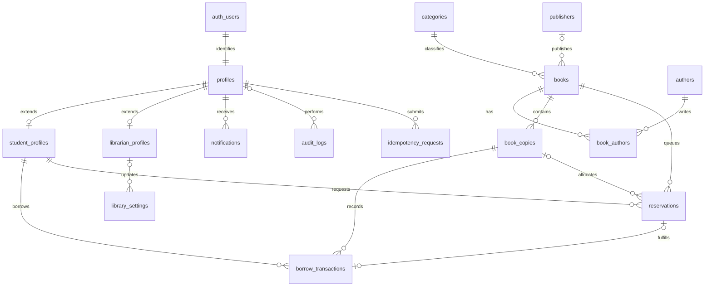
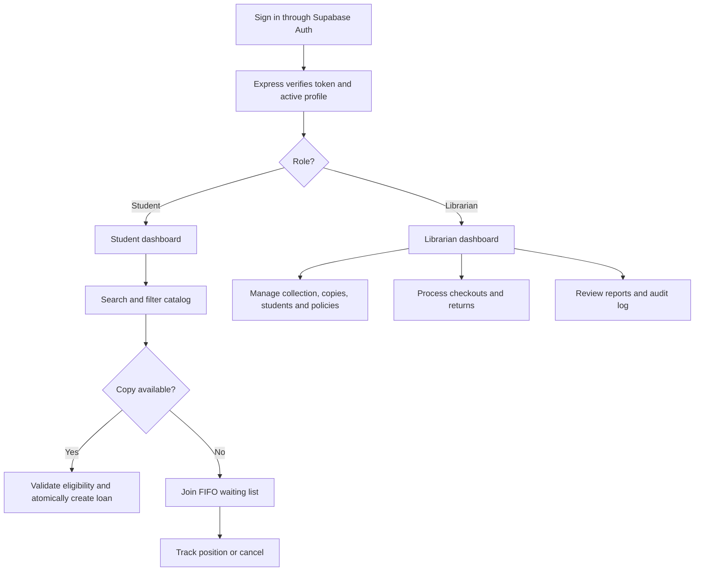
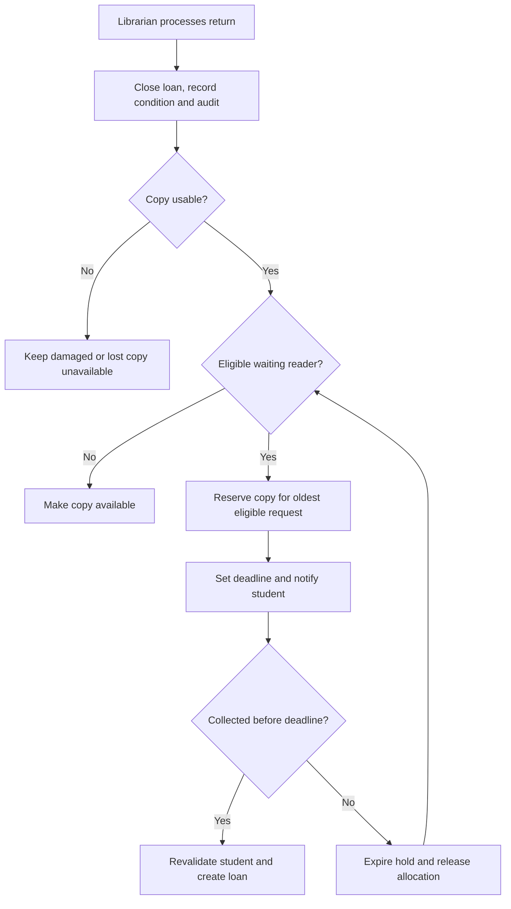

# Database and user workflows

Waiting positions are computed from WAITING records ordered by created_at and UUID. Inactive, manually restricted and overdue-restricted readers are not promoted while ineligible. Deactivation or a manual restriction cancels their active reservations. A student who has reached their loan limit can hold a pickup reservation but must become eligible before collecting it. Deadlines are enforced in SQL even if a worker runs late.

Copies have AVAILABLE, BORROWED, RESERVED, DAMAGED, LOST or MAINTENANCE status, plus an independent condition and retirement timestamp. Loans are ACTIVE, RETURNED or LOST; overdue is derived from due_at. Reservation states are WAITING, READY_FOR_PICKUP, COMPLETED, CANCELLED and EXPIRED. Existing loan due dates and existing pickup deadlines are preserved when policies change.
